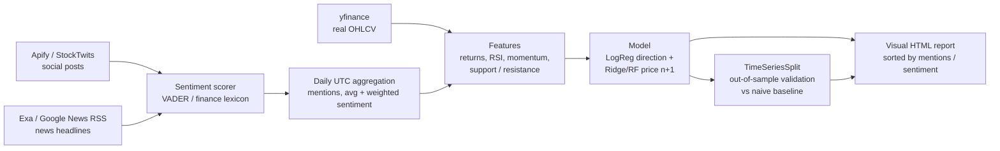

# CWT Sentiment Agent — Hang Seng (HK) + KRX (Korea)

A Python sentiment pipeline that predicts an asset's price at **n+1** (next
trading day) from **two sentiment sources**, for 5 assets on the Hang Seng
and 5 assets on KRX — with rigorous out-of-sample validation and a visual
report sorted by social mentions / sentiment per exchange.

Built for the CrowdWisdomTrading (CWT) AI Agent Developer intern assignment.

## What it does

| Step | How |
|---|---|
| Social posts (Source 1) | **Apify** (X/Twitter search actor) when `APIFY_TOKEN` is set → else **StockTwits public API** (real posts, ADR symbol) → else clearly-labelled demo fallback |
| News (Source 2) | **Exa** (`api.exa.ai/search`) when `EXA_API_KEY` is set → else **Google News RSS** (real recent headlines, no key needed) → else demo fallback |
| Prices | **yfinance** real OHLCV (~6 months); seeded synthetic fallback only if Yahoo is unreachable |
| Sentiment | VADER if installed, else a built-in finance lexicon scorer (−1..+1), no heavy downloads |
| Features | Daily UTC-aligned: mention count, avg + engagement-weighted sentiment, 1/5/10-day returns, RSI-14, volatility, volume ratio, support/resistance (20-day rolling high/low + pivot points) |
| Model | Direction: Logistic Regression · Price n+1: Ridge + RandomForest ensemble on next-day return |
| Validation | **TimeSeriesSplit (5 splits), walk-forward, never shuffled** — accuracy & MAE vs a naive baseline, plus a backtest table of the most recent out-of-sample split |
| Output | Visual HTML report + `predictions.csv` + `summary.json` |

## Architecture



## Assets

**Hang Seng (HK):** 0700.HK Tencent · 9988.HK Alibaba · 3690.HK Meituan ·
1810.HK Xiaomi · 2318.HK Ping An
**KRX (Korea):** 005930.KS Samsung Electronics · 000660.KS SK Hynix ·
035420.KS NAVER · 035720.KS Kakao · 005380.KS Hyundai Motor

Each ticker in `config.py` carries keywords/cashtags for search, plus a
StockTwits ADR symbol (HK/KRX tickers have no native StockTwits stream).

## Setup

```bash
git clone <this-repo>
cd cwt-sentiment-agent
python -m venv .venv
# Windows: .venv\Scripts\activate   |   macOS/Linux: source .venv/bin/activate
pip install -r requirements.txt
```

### API keys (optional — the pipeline runs without them)

Copy `.env.example` to `.env` and fill in:

```
APIFY_TOKEN=your_apify_token_here
EXA_API_KEY=your_exa_api_key_here
```

> ⚠️ **NEVER commit real tokens.** `.env` is in `.gitignore`. Only the
> **actor IDs** (public identifiers, below) are shared for reproducibility —
> never the raw private tokens.

**Apify actor IDs used (public, shareable):**
- X/Twitter search: `apidojo/tweet-scraper`
- Alternative: `kaitoeasyapi/twitter-x-data-tweet-scraper-pay-per-result-cheapest`
- Reddit search (second social source option): `trudax/reddit-scraper`

Assignment-listed local sources (LIHKG, Futu/Moomoo, Naver Finance boards,
Daum, KakaoTalk, Blind, AAStocks/ETNet) do not offer public APIs; the
Apify X/Reddit actors + StockTwits are the reproducible programmatic
equivalents, and the actor layer in `src/social_apify.py` is where a
LIHKG/Naver Apify actor can be dropped in when one is available.

## Run

```bash
python main.py
```

Outputs in `output/`:
- `report.html` — visual report (charts + tables sorted by mentions/sentiment + per-ticker cards)
- `predictions.csv` — one row per ticker: price, sentiment, direction, position, support/resistance, predicted n+1
- `summary.json` — data modes + per-ticker validation metrics
- `backtest_last_split.csv` — "check your results": most recent out-of-sample predictions vs actuals

**Position rule:** Long = model predicts up >0.3% AND sentiment > +0.05 ·
Short = model predicts down >0.3% AND sentiment < −0.05 · otherwise Neutral.

## Model validation — honestly

- Features are known at close of day *n*; the target is day *n+1*. No
  shuffling, no look-ahead: `TimeSeriesSplit` always trains on the past and
  tests on the future.
- Every metric is reported **against a naive baseline** (direction = sign of
  last return; price = today's close). In the included sample run
  (`output/summary.json`, real prices + real news): average out-of-sample
  direction accuracy ≈ **0.51** across the 10 tickers, beating the naive
  direction baseline on 6/10 tickers; price MAE does **not** beat the naive
  baseline — a well-known hard result for daily price levels, reported
  as-is rather than hidden.
- The real social/news window is the assignment's 10 days. For training
  over ~140 days, earlier daily sentiment is a **seeded AR(1) proxy series**
  (`src/features.py`), overwritten by the real aggregated sentiment for the
  most recent days. Price/technical features are real throughout when
  yfinance is reachable. This limitation is stated openly: with live
  Apify/Exa keys and a longer collection window, the proxy is replaced by
  fully real history.

## Project structure

```
config.py            tickers, keywords, actor IDs, env loading
main.py              end-to-end CLI
src/price_data.py    yfinance real prices + synthetic fallback
src/news_exa.py      Exa -> Google News RSS -> demo
src/social_apify.py  Apify -> StockTwits -> demo
src/sentiment.py     VADER / finance-lexicon scorer
src/features.py      daily aggregation, RSI, support/resistance
src/model.py         TimeSeriesSplit validation + n+1 prediction
src/report.py        visual HTML report + matplotlib charts
```

## Submission checklist

- [ ] Repo pushed to GitHub (link in the submission email)
- [ ] `.env` NOT committed (check: no tokens anywhere in the repo)
- [ ] `python main.py` runs clean and regenerates `output/`
- [ ] Submission email sent to gilad@crowdwisdomtrading.com with the repo
      link + Apify/Exa **actor IDs** (not raw tokens) — see `SUBMISSION_EMAIL.md`
- [ ] Sample outputs in `output/` included so results are visible without running

*Research prototype — not financial advice.*
